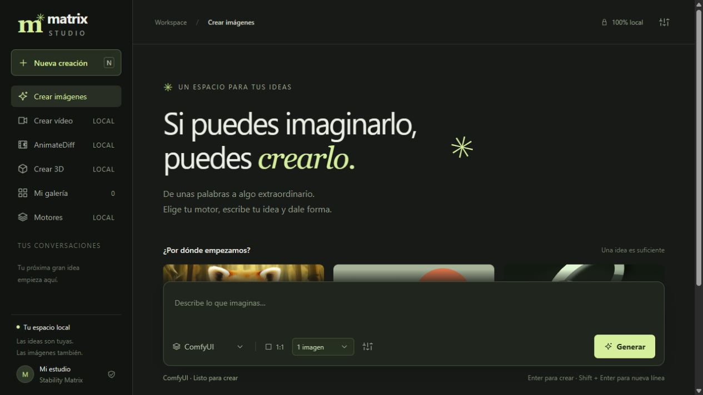

# Matrix Studio Local

**[Español](README.md) | [English](README.en.md)**

A local web interface with conversations and a gallery for creating **images, videos, and 3D models** through several engines. Works with a Stability Matrix-managed installation or a standalone ComfyUI installation.

**The published code contains no model weights, conversations, private images, logs, or development-machine settings.** Models are downloaded separately from their distributors and verified with SHA256.



## Features

| Feature | Technology | Output |
|---|---|---|
| Image chat | ComfyUI, SD 1.5 / SDXL checkpoints; Automatic1111 / Forge API | PNG, batches of 1, 2, 4, or 8 images |
| Image-to-video | Wan 2.2 TI2V 5B Q5_K_M or I2V 14B Q3_K_S | H.264 MP4, 24 fps for 5B / 16 fps for 14B |
| Creative animation | AnimateDiff Evolved v2/v3 + SD 1.5, camera Motion LoRA | MP4; text-to-video or an initial reference |
| Smoothing | ComfyUI native RIFE 4.26 | Optional intermediate frames in AnimateDiff |
| Longer videos | Scene planner, different seeds, and PyAV | Montages up to 120 seconds; 1–5 videos per batch |
| Image-to-3D | TRELLIS.2 INT8, DINOv3, BiRefNet, and native ComfyUI nodes | Geometry-only, vertex-colored, or PBR GLB |
| 3D viewer | Locally served Google model-viewer 4.4.0 | GLB rotation and zoom |
| Optional Qwen | Adapter for stable-diffusion.cpp / CUDA | PNG using a compatible set of weights |
| Library | SQLite, local files, recoverable deletion | History, gallery, downloads, and Undo |

The UI uses HTML/CSS/JavaScript without a frontend build. The Python/aiohttp server uses a shared queue to process one job at a time. Docker, Node.js, a paid API, and uploading reference images to a Space are not required.

This is the English documentation. The application currently uses Spanish interface labels; the instructions below retain those labels where needed. Supporting technical guides linked below are in Spanish.

## Tested hardware

| Component | Reference machine |
|---|---|
| GPU | NVIDIA GeForce RTX 5060 Laptop GPU, 8 GB VRAM |
| CPU | Intel Core i7-14650HX |
| RAM | 16 GB, approximately 15.6 GiB usable |
| OS | Windows 11 x64 |
| NVIDIA driver | 616.92 |
| Python | 3.12.14 |
| PyTorch / torchvision | 2.14.1+cu130 / 0.29.1+cu130 |

This documents an actual configuration; it **does not guarantee** that every model, resolution, or prompt will work with 8 GB. The entire infrastructure has not been reinstalled from scratch on a second machine. The publication copy has been checked using isolated tests and an empty session. See [hardware, tests, and limits](docs/HARDWARE.md).

## Required downloads

1. [Python 3.12 x64](https://www.python.org/downloads/windows/), Git, and `curl.exe` available in PATH.
2. An [NVIDIA driver](https://www.nvidia.com/Download/index.aspx) compatible with CUDA 13.0. The tested driver is listed above.
3. [ComfyUI](https://github.com/Comfy-Org/ComfyUI) and two extensions: [ComfyUI-GGUF](https://github.com/city96/ComfyUI-GGUF) and [AnimateDiff Evolved](https://github.com/Kosinkadink/ComfyUI-AnimateDiff-Evolved). The installer downloads commits pinned in [infrastructure.json](infrastructure.json).
4. PyTorch and torchvision from the official `https://download.pytorch.org/whl/cu130` index; these wheels include the runtime needed for that branch. A full CUDA Toolkit installation is not prescribed for the normal Python workflow.
5. Weights for the modules you want to use. The complete inventory, sizes, repositories, and destination paths are in [MODELS.md](docs/MODELS.md).

Installing every module requires 41.43 GB of model weights; see the generated exact total in MODELS.md. Allow extra space for Python, PyTorch, repositories, caches, and outputs. Start with the engines you need: Wan 5B supports the reference-image video workflow; the AnimateDiff package includes checkpoints for image generation.

## Standalone installation on Windows

Open PowerShell in the folder where you want to store the project:

```powershell
git clone https://github.com/f3r4lonso/matrix-studio-local.git
cd matrix-studio-local

# Preview the plan without downloading or changing anything.
.\scripts\setup-local.ps1 -PlanOnly

# Python must be from the 3.12 series.
.\scripts\setup-local.ps1 -Python python
```

The installer creates `Data/Engines/ComfyUI/venv`, pins engine commits, installs dependencies, and generates `Data/matrix-studio-model-paths.yaml` with paths for **your** installation. It does not change execution policies, firewall settings, or system environment variables. If PowerShell blocks scripts, review the code and your terminal settings; the installer does not change the policy automatically.

Set the path to the Python executable created above:

```powershell
$py = '.\Data\Engines\ComfyUI\venv\Scripts\python.exe'
```

Download only your chosen modules:

```powershell
# 5B video: model, VAE, and shared UMT5 encoder.
& $py MatrixStudio/install_wan5b.py

# SD 1.5 images and animation: checkpoints, motion models, LoRA, and RIFE.
& $py MatrixStudio/install_animatediff.py

# Optional: 14B and 3D.
& $py MatrixStudio/install_wan.py
& $py MatrixStudio/install_trellis.py
```

Installers use `curl.exe`, resume `.part` files, and verify SHA256 before accepting a download. Weights are not stored in Git.

Start the UI:

```powershell
.\scripts\start-local.ps1
```

You can also use `Abrir Matrix Studio.cmd`. Open **http://127.0.0.1:7880/** and select **Motores → Iniciar ComfyUI** (Engines → Start ComfyUI), or the corresponding video/3D button. ComfyUI uses **127.0.0.1:8188**. Keep the Studio process running while generating.

To start ComfyUI manually, open another terminal at the repository root:

```powershell
& $py Data/Engines/ComfyUI/main.py `
  --listen 127.0.0.1 --port 8188 --use-pytorch-cross-attention `
  --extra-model-paths-config Data/matrix-studio-model-paths.yaml
```

Do not expose this application as a public service: it is designed for loopback access, without multi-user accounts or Internet-facing authentication.

## Using existing infrastructure

Stability Matrix is optional. You can use its existing ComfyUI installation or a manually installed one. It must contain the required versions and nodes and load this project's model configuration.

```powershell
# Generic example: this installs/updates packages in that environment.
# To preserve an existing installation, use the new installation described above.
.\scripts\setup-local.ps1 -UseExistingComfy -ComfyDir 'D:/AI/ComfyUI'
.\scripts\start-local.ps1 -ComfyDir 'D:/AI/ComfyUI'
```

An already running ComfyUI instance must be restarted with `--extra-model-paths-config` to discover the new folders. The script does not overwrite a checkout at a different version. If you manually choose another version, check its nodes again with the diagnostic tool.

Install Automatic1111/Forge from its distributor with a compatible checkpoint, start it with `--api`, and configure its local URL under **Motores**. Its full installation is neither automated nor validated from scratch in this release. Qwen is also optional: see [its guide to binaries, weights, and CUDA](QwenImageLocal/README.md).

## Local checks

With ComfyUI running:

```powershell
& $py scripts/check_environment.py --module wan5b
# Alternatives: core, wan14b, animatediff, trellis, all.

& $py -W ignore -m unittest discover -s MatrixStudio/tests -q
```

The diagnostic checks versions, CUDA, weight files, and node availability; it does not certify visual quality. The 33 application tests cover API limits, simulated engine integration, model and VAE paths, batches, deletion/Undo, montage assembly using actual MP4 timing, and resuming jobs. They do not run neural models.

## Usage and settings

### Images

Select ComfyUI and an SD 1.5 or SDXL checkpoint, enter a description, and choose a batch size. Each image uses a different seed. Enter generates; Shift+Enter inserts a line break. **Más variaciones** (More variations) prepares four more images from the same prompt. Different model architectures require their own workflows; selecting an arbitrary weights file is not sufficient.

### Wan video

Upload a PNG/JPG/WebP reference up to 20 MB, or select **Animar imagen** (Animate image) in the gallery. Start with Wan 5B on the reference hardware, describe a short action, and inspect one clip before requesting a long montage.

| Profile | Wan 5B | Wan 14B |
|---|---|---|
| Preview | 10 steps, base model | 4 steps + LightX2V, CFG 1, shift 5 |
| Balanced | 20 steps, UniPC/simple, CFG 5, shift 5 | 20 steps, UniPC/simple, CFG 3.5, shift 3 |
| Full | 50 steps, original reference settings | 40 steps, no acceleration LoRA |

Advanced controls expose steps, CFG, shift, and the negative prompt. The [Comfy 5B example](https://github.com/Comfy-Org/workflow_templates/blob/main/templates/video_wan2_2_5B_ti2v.json) uses 20 steps and shift 8; the [original Wan 5B code](https://github.com/Wan-Video/Wan2.2/blob/main/wan/configs/wan_ti2v_5B.py) uses 50 steps, CFG 5, and shift 5. These are different configurations, not a guarantee that increasing every value improves the video. The native example size of 1280 × 704 is offered for 5B at a higher resource cost; the initial 640 × 384 setting is a resource compromise.

### Montages up to 120 seconds

Select **Duración total** (Total duration), optionally enter one action per line in the scene script, and choose 1–5 videos. Each scene is generated with a new seed and the original reference image when provided. Shots are joined with cuts; this does not produce a single continuous shot, repeat a clip, or freeze its ending. If the script has fewer lines than the required number of shots, it is reused with new seeds. The last shot is trimmed to reach the requested duration exactly.

Content duration differs from render time. In testing, a roughly five-second 5B shot at 640 × 384 took about 223 seconds; a two-minute montage may take over an hour. Completed scenes are stored in `video_projects/<id>` inside the data directory. If a job fails or Studio restarts, **Reanudar montaje** (Resume montage) keeps those shots and continues the remaining work.

### AnimateDiff

Use SD 1.5 with v2 or v3. The people profiles select DreamShaper or Realistic Vision + MSE VAE. ZoomOut/PanLeft Motion LoRAs require v2. FreeNoise is enabled for scenes longer than 16 frames, with context length 16 and overlap 8. Optional RIFE smooths the output; it does not fix hands or body contact, or add choreography. Reference mode repeats the initial latent and is not equivalent to SparseCtrl, ControlNet, or a precisely fixed first frame.

### TRELLIS.2

Use a clear image of an object, preferably isolated. Generate geometry at 512³ and export a geometry-only, vertex-colored, or PBR-textured GLB. Hidden surfaces are inferred by the model. Previews with 8 steps and a target of approximately 30,000 faces were tested; performance for complex scenes or higher resolutions is not guaranteed.

## Architecture and data

```text
Local browser (HTML/CSS/JS)
       | HTTP / JSON
Python aiohttp :7880 ---- SQLite + local files
       | sequential queue
       +---- ComfyUI :8188 (images / video / 3D)
       +---- Automatic1111 / Forge :7860 (optional)
       +---- sd-cli / CUDA (optional Qwen)
```

The public launcher stores data in `Runtime/`; running `server.py` directly defaults to its application directory. You can set `MATRIX_STUDIO_DATA_DIR`. Other variables include `MATRIX_STUDIO_PORT`, `MATRIX_STUDIO_COMFY_DIR`, `MATRIX_STUDIO_COMFY_PYTHON`, and the Qwen variables documented in its guide.

History is stored in `studio.db`; generated files in `outputs`; references in `inputs`; deleted outputs in `trash`; and recoverable scenes in `video_projects`. Deleting a chat hides the conversation and keeps its outputs in the gallery. Deleting an output moves the final file to the trash and supports Undo; references and recovery scenes remain on disk. All these data are excluded from Git.

Further details: [API and structure](docs/ARCHITECTURE.md), [troubleshooting](docs/TROUBLESHOOTING.md), [privacy review](docs/PRIVACY.md), and [licenses](THIRD_PARTY_NOTICES.md). These supporting guides are in Spanish.

## Publication and quality limits

The repository contains only reviewed code and assets. Publication commits use a generic identity to avoid exposing the name or email configured on the development machine. GitHub still displays the repository owner's public account; publication is not anonymous.

Databases, outputs, references, private experiments, old screenshots, executables, models, environments, connection settings, and credentials are excluded. The interface screenshot comes from an empty session, and the panda illustration retains no generation metadata. The [English Hugging Face post](docs/HUGGING_FACE_POST.en.md) is ready to adapt and publish; the [Spanish version](docs/HUGGING_FACE_POST.md) is also available.

Actual video tests improved some motion and color aspects but still showed merged bodies and unnatural contact in fighting scenes. This project does not guarantee reliable photorealistic video, pose control, perfect identity preservation, or cinematic quality. Short AI montages of 6 and 10 seconds were generated; 120-second output was checked in the assembler using synthetic scenes, **not with a complete two-minute AI render**. Windows/NVIDIA is the validated platform; Linux, macOS, AMD, and other GPUs remain unverified.

Original code is licensed under [MIT](LICENSE). External models and components retain their own licenses.

## Asset organization and model catalog

Fresh installations use `Data/Engines` for engines and `Data/Models` for checkpoints, encoders, VAEs and LoRAs. Runtime paths are configurable; existing installations remain usable. See [asset layout and inventory](docs/LOCAL_ASSETS.md). The [image catalog](docs/IMAGE_MODELS.md) documents eight checkpoints with versions, sources, SHA256, VAE information and suggested settings; these entries are not all installed or tested. [Five-second sparring trials](docs/VIDEO_TUNING.md) record settings and remaining motion artifacts. These supporting guides are in Spanish.

## Queue controls and gallery provenance

**Detener actual** stops Studio's active generation and pauses its queue. **Pausar cola** lets the active job finish and holds subsequent jobs. **Continuar** resumes pending work. An interrupted item restarts with its saved settings and seed; completed montage scenes are retained. Pause state survives a restart. See [queue behavior, API and engine limitations](docs/QUEUE_CONTROLS.md).

Every gallery card shows its recorded engine and model; missing historical metadata is identified explicitly. Deleting a result is immediate, with Undo available for 15 seconds. The optional [Forge installer](docs/FORGE.md) shares the project's checkpoints, VAEs and LoRAs. The selected-image installer verifies sizes and SHA256 hashes before accepting downloaded files. Architecture-specific action adapters and five-second continuation trials are documented in [video tuning](docs/VIDEO_TUNING.md). The public suite includes 51 isolated tests.

## JSON image batches

**Lotes JSON** accepts one object or an array with `nombre`, `prompt` and `negative_prompt`, preserving optional `numero` and `numero_pokedex` metadata. One image is generated per entry in file order, with persistent progress. Errors pause the queue; Continue retries the failed image before advancing. Import includes a preview, a downloadable example and deduplication of identical batches. See [format and recovery](docs/JSON_BATCHES.md).

## GPU cleanup between jobs

The default-on **Liberar VRAM entre generaciones** option requests model/cache release from idle backends before and after jobs. **Liberar ahora** requests manual cleanup while Studio is idle. See [behavior and limitations](docs/GPU_MEMORY.md). This change is pending functional and GPU testing; restart the server to activate it.

## Albums and compact gallery

Each JSON batch has a collectible album with a cover, numbered cards and placeholders for pending images. Compact cards show less information; full descriptions contain prompts, settings and actions. Large browser windows display four or five columns. See [gallery behavior](docs/GALLERY_ALBUMS.md). Visual and functional validation is pending; no tests were run for this update.
