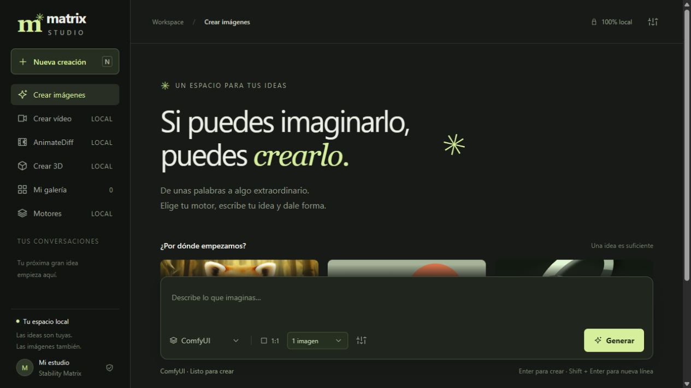

# Matrix Studio Local

**[Español](README.md) | [English](README.en.md)**

Una interfaz web local, con conversaciones y galería, para crear **imágenes, vídeos y modelos 3D** desde varios motores. Compatible con una instalación gestionada por Stability Matrix y con una instalación independiente de ComfyUI.

**El código se publica sin pesos, conversaciones, imágenes privadas, registros ni configuraciones del equipo de desarrollo.** Los modelos se descargan por separado desde sus distribuidores y se verifican con SHA256.



## Qué incluye

| Función | Tecnología | Resultado |
|---|---|---|
| Chat de imágenes | ComfyUI, checkpoints SD 1.5 / SDXL; API de Automatic1111 / Forge | PNG, lotes de 1, 2, 4 u 8 imágenes |
| Vídeo desde imagen | Wan 2.2 TI2V 5B Q5_K_M o I2V 14B Q3_K_S | MP4 H.264, 24 fps en 5B / 16 fps en 14B |
| Animación creativa | AnimateDiff Evolved v2/v3 + SD 1.5, Motion LoRA de cámara | MP4; texto a vídeo o referencia inicial |
| Suavizado | RIFE 4.26 nativo de ComfyUI | Fotogramas intermedios opcionales en AnimateDiff |
| Vídeo largo | Planificador por escenas, semillas distintas y PyAV | Montajes de hasta 120 segundos; 1–5 vídeos por lote |
| Imagen a 3D | TRELLIS.2 INT8, DINOv3, BiRefNet y nodos nativos de ComfyUI | GLB de geometría, color por vértices o PBR |
| Visor 3D | Google model-viewer 4.4.0 servido localmente | Rotación y zoom del GLB |
| Qwen opcional | Adaptador para stable-diffusion.cpp / CUDA | PNG mediante un conjunto de pesos compatible |
| Biblioteca | SQLite, archivos locales, borrado recuperable | Historial, galería, descarga y Deshacer |

La UI es HTML/CSS/JavaScript sin compilación de frontend. El servidor es Python/aiohttp y utiliza una cola compartida para procesar un trabajo cada vez. No necesitas Docker, Node.js, una API de pago ni subir tus referencias a un Space.

## Hardware que se ha probado

| Componente | Equipo de referencia |
|---|---|
| GPU | NVIDIA GeForce RTX 5060 Laptop GPU, 8 GB de VRAM |
| CPU | Intel Core i7-14650HX |
| RAM | 16 GB, aproximadamente 15,6 GiB utilizables |
| Sistema | Windows 11 x64 |
| Driver NVIDIA | 616.92 |
| Python | 3.12.14 |
| PyTorch / torchvision | 2.14.1+cu130 / 0.29.1+cu130 |

Esto documenta una configuración real, **no garantiza** que cualquier modelo, resolución o prompt funcione con 8 GB. No se ha reinstalado toda la infraestructura en otro equipo desde cero. La versión publicable sí se comprueba con pruebas aisladas y una sesión sin datos. Consulta [hardware, pruebas y límites](docs/HARDWARE.md).

## Descargas necesarias

1. [Python 3.12 x64](https://www.python.org/downloads/windows/), Git y `curl.exe` disponibles en PATH.
2. Un [driver NVIDIA](https://www.nvidia.com/Download/index.aspx) compatible con CUDA 13.0. El driver probado está en la tabla anterior.
3. [ComfyUI](https://github.com/Comfy-Org/ComfyUI) y dos extensiones: [ComfyUI-GGUF](https://github.com/city96/ComfyUI-GGUF) y [AnimateDiff Evolved](https://github.com/Kosinkadink/ComfyUI-AnimateDiff-Evolved). El instalador descarga commits fijados en [infrastructure.json](infrastructure.json).
4. PyTorch y torchvision desde el índice oficial `https://download.pytorch.org/whl/cu130`; las ruedas incluyen el runtime necesario para esa rama. No se prescribe instalar un CUDA Toolkit completo para el flujo Python normal.
5. Los pesos del módulo que vayas a utilizar. El inventario completo, tamaños, repositorios y destinos está en [MODELS.md](docs/MODELS.md).

El inventario suma 41,43 GB de pesos si instalas todos los módulos; consulta la suma exacta generada en MODELS.md. Reserva espacio adicional para Python, PyTorch, repositorios, cachés y resultados. Para empezar no descargues todos los motores: Wan 5B basta para el flujo de vídeo con una referencia; el conjunto AnimateDiff aporta checkpoints para crear imágenes.

## Instalación independiente en Windows

En una terminal PowerShell, desde la carpeta donde quieras guardar el proyecto:

```powershell
git clone https://github.com/f3r4lonso/matrix-studio-local.git
cd matrix-studio-local

# Ver el plan sin descargar ni modificar nada.
.\scripts\setup-local.ps1 -PlanOnly

# Python debe ser de la rama 3.12.
.\scripts\setup-local.ps1 -Python python
```

El instalador crea `Data/Engines/ComfyUI/venv`, fija los commits de los motores, instala dependencias y genera `Data/matrix-studio-model-paths.yaml` con las rutas de **tu** instalación. No modifica políticas de ejecución, firewall ni variables del sistema. Si tu política de PowerShell bloquea scripts, revisa el código y la configuración de tu terminal; el instalador no la cambia automáticamente.

Activa el Python creado:

```powershell
$py = '.\Data\Engines\ComfyUI\venv\Scripts\python.exe'
```

Descarga únicamente los módulos elegidos:

```powershell
# Vídeo 5B: modelo, VAE y codificador UMT5 compartido.
& $py MatrixStudio/install_wan5b.py

# Imágenes SD 1.5 y animación: checkpoints, motion models, LoRA y RIFE.
& $py MatrixStudio/install_animatediff.py

# Opcionales: 14B y 3D.
& $py MatrixStudio/install_wan.py
& $py MatrixStudio/install_trellis.py
```

Los instaladores usan `curl.exe`, reanudan archivos `.part` y comprueban su SHA256 antes de dar la descarga por válida. Los pesos no forman parte de Git.

Arranca la UI:

```powershell
.\scripts\start-local.ps1
```

También puedes usar `Abrir Matrix Studio.cmd`. Abre **http://127.0.0.1:7880/** y pulsa **Motores → Iniciar ComfyUI**, o el botón equivalente de vídeo/3D. ComfyUI utiliza **127.0.0.1:8188**. Mantén el proceso de Studio abierto mientras generas.

Si prefieres iniciar ComfyUI manualmente, en otra terminal, desde la raíz:

```powershell
& $py Data/Engines/ComfyUI/main.py `
  --listen 127.0.0.1 --port 8188 --use-pytorch-cross-attention `
  --extra-model-paths-config Data/matrix-studio-model-paths.yaml
```

No expongas esta aplicación como servicio público: está diseñada para loopback, sin cuentas multiusuario ni autenticación para Internet.

## Usar una infraestructura existente

Stability Matrix es opcional. Puedes utilizar su ComfyUI existente o uno instalado manualmente. Debe contener las versiones y nodos necesarios y cargar la configuración de modelos de este proyecto.

```powershell
# Ejemplo genérico: esta opción instala/actualiza paquetes en ese entorno.
# Para conservar una instalación existente intacta, usa la instalación nueva de arriba.
.\scripts\setup-local.ps1 -UseExistingComfy -ComfyDir 'D:/AI/ComfyUI'
.\scripts\start-local.ps1 -ComfyDir 'D:/AI/ComfyUI'
```

Un ComfyUI que ya estuviera ejecutándose debe reiniciarse con `--extra-model-paths-config` para ver las nuevas carpetas. El script no sobrescribe el checkout de una versión distinta. Si eliges otra versión manualmente, vuelve a comprobar los nodos con el diagnóstico.

Automatic1111/Forge se instala desde su distribuidor, con un checkpoint compatible, y debe arrancarse con `--api`; configura su URL local en **Motores**. Su instalación completa no se automatiza ni se ha validado de cero en esta publicación. Qwen es igualmente opcional: consulta [su guía de binarios, pesos y CUDA](QwenImageLocal/README.md).

## Comprobaciones locales

Con ComfyUI arrancado:

```powershell
& $py scripts/check_environment.py --module wan5b
# Alternativas: core, wan14b, animatediff, trellis, all.

& $py -W ignore -m unittest discover -s MatrixStudio/tests -q
```

El diagnóstico comprueba versiones, CUDA, archivos de pesos y disponibilidad de nodos; no certifica la estética del resultado. Las 33 pruebas de aplicación cubren límites de la API, integración con motores simulados, rutas de modelos y VAE, lotes, borrado/Deshacer, montajes con reloj real de MP4 y reanudación. No ejecutan los modelos neuronales.

## Uso y ajustes

### Imágenes

Selecciona ComfyUI y un checkpoint SD 1.5 o SDXL, escribe una descripción y elige el lote. Cada imagen utiliza una semilla distinta. Enter genera; Shift+Enter añade una línea. **Más variaciones** prepara otras cuatro imágenes del mismo prompt. Los modelos de arquitecturas diferentes necesitan su propio workflow; no basta con seleccionar cualquier archivo de pesos.

### Vídeo Wan

Sube una referencia PNG/JPG/WebP de hasta 20 MB o utiliza **Animar imagen** en la galería. Elige Wan 5B para empezar en este equipo, describe una acción breve y comprueba un clip antes de solicitar un montaje largo.

| Perfil | Wan 5B | Wan 14B |
|---|---|---|
| Vista previa | 10 pasos, modelo base | 4 pasos + LightX2V, CFG 1, shift 5 |
| Equilibrado | 20 pasos, UniPC/simple, CFG 5, shift 5 | 20 pasos, UniPC/simple, CFG 3.5, shift 3 |
| Completo | 50 pasos, configuración original de referencia | 40 pasos, sin LoRA de aceleración |

Los controles avanzados permiten ajustar pasos, CFG, shift y negativo. El [ejemplo de Comfy 5B](https://github.com/Comfy-Org/workflow_templates/blob/main/templates/video_wan2_2_5B_ti2v.json) usa 20 pasos y shift 8; el [código original de Wan 5B](https://github.com/Wan-Video/Wan2.2/blob/main/wan/configs/wan_ti2v_5B.py) utiliza 50 pasos, CFG 5 y shift 5. Son configuraciones distintas, no una garantía de que aumentar todos los valores mejore el vídeo. Para 5B se ofrece el tamaño nativo de ejemplo 1280 × 704, con más coste; el valor inicial 640 × 384 es un compromiso de recursos.

### Montajes de hasta 120 segundos

Selecciona **Duración total**, opcionalmente escribe una acción por línea en el guion y elige 1–5 vídeos. Cada escena se genera de nuevo con otra semilla y con la referencia original cuando existe. Hay cortes entre planos; no se trata de un único plano continuo, ni de repetir un vídeo o congelar su final. Si faltan líneas de guion para tantos planos, se recorre el guion de nuevo con semillas nuevas. El último plano se recorta para alcanzar exactamente la duración solicitada.

La duración del contenido no es el tiempo de render. En las pruebas, un plano 5B de unos 5 segundos a 640 × 384 tardó aproximadamente 223 segundos; dos minutos pueden requerir más de una hora. Las escenas terminadas quedan en `video_projects/<id>` dentro del directorio de datos. Si el trabajo falla o se reinicia Studio, **Reanudar montaje** conserva esos planos y continúa el cálculo pendiente.

### AnimateDiff

Utiliza SD 1.5 con v2 o v3. Los perfiles de personas seleccionan DreamShaper o Realistic Vision + VAE MSE. Las Motion LoRA ZoomOut/PanLeft requieren v2. FreeNoise se activa en escenas mayores de 16 fotogramas, con contexto 16 y solapamiento 8. RIFE opcional suaviza la salida; no corrige manos, contactos corporales ni añade una coreografía. El modo de referencia repite el latente inicial y no equivale a SparseCtrl, ControlNet ni un primer fotograma fijado con precisión.

### TRELLIS.2

Utiliza una imagen clara de un objeto, preferiblemente aislado. Genera geometría a 512³ y exporta GLB con solo geometría, color por vértices o texturas PBR. La reconstrucción de las caras ocultas es una inferencia del modelo. Se probaron vistas previas de 8 pasos y unas 30.000 caras objetivo; no se promete rendimiento de escenas complejas o de mayor resolución.

## Arquitectura y datos

```text
Navegador local (HTML/CSS/JS)
       | HTTP / JSON
Python aiohttp :7880 ---- SQLite + archivos locales
       | cola secuencial
       +---- ComfyUI :8188 (imágenes / vídeo / 3D)
       +---- Automatic1111 / Forge :7860 (opcional)
       +---- sd-cli / CUDA (Qwen opcional)
```

El lanzador público utiliza `Runtime/` para los datos; ejecutar directamente `server.py` utiliza por defecto su carpeta de aplicación. Puedes definir `MATRIX_STUDIO_DATA_DIR`. También existen `MATRIX_STUDIO_PORT`, `MATRIX_STUDIO_COMFY_DIR`, `MATRIX_STUDIO_COMFY_PYTHON` y las variables Qwen documentadas en su guía.

El historial se guarda en `studio.db`; los resultados, en `outputs`; las referencias, en `inputs`; la papelera, en `trash`; y las escenas recuperables, en `video_projects`. Borrar un chat oculta la conversación y conserva sus resultados en la galería. Borrar un resultado mueve el archivo final a la papelera y permite Deshacer; las referencias y escenas de recuperación permanecen en disco. Todo ello queda excluido de Git.

Más detalles: [API y estructura](docs/ARCHITECTURE.md), [solución de problemas](docs/TROUBLESHOOTING.md), [revisión de privacidad](docs/PRIVACY.md) y [licencias](THIRD_PARTY_NOTICES.md).

## Publicación y límites de calidad

El repositorio contiene solo código y recursos revisados. Los commits de esta publicación utilizan una identidad genérica para no publicar el correo o nombre configurados en el equipo. GitHub seguirá mostrando la cuenta pública propietaria del repositorio; la publicación no es anónima.

Se han excluido las bases de datos, resultados, referencias, experimentos privados, capturas antiguas, ejecutables, modelos, entornos, configuración de conexiones y credenciales. La imagen de interfaz procede de una sesión vacía y el recurso ilustrativo del panda no conserva metadatos de generación. El [texto para Hugging Face](docs/HUGGING_FACE_POST.md) está listo para adaptar y publicar.

Las pruebas reales de vídeo mejoraron algunos aspectos de movimiento y color, pero siguieron mostrando fusiones de cuerpos y contactos poco naturales en escenas de lucha. Este proyecto no garantiza vídeo fotorrealista fiable, control de pose, identidad perfecta ni calidad cinematográfica. Se probó generación IA de montajes cortos de 6 y 10 segundos; los 120 segundos se comprobaron en el ensamblador con escenas sintéticas, **no con un render IA completo de dos minutos**. Windows/NVIDIA es la plataforma validada; Linux, macOS, AMD y otras GPU quedan por comprobar.

Código original bajo [MIT](LICENSE). Los modelos y componentes externos conservan sus propias licencias.

## Organización de motores y catálogo

Las instalaciones nuevas agrupan motores en `Data/Engines` y checkpoints, codificadores, VAE y LoRAs en `Data/Models`. Las rutas son configurables y se mantienen las instalaciones anteriores: consulta [estructura e inventario](docs/LOCAL_ASSETS.md). El [catálogo de imágenes](docs/IMAGE_MODELS.md) documenta ocho checkpoints con versión, origen, SHA256, VAE y ajustes; no significa que todos estén instalados o probados. Las [pruebas de sparring de cinco segundos](docs/VIDEO_TUNING.md) recogen parámetros y defectos de movimiento pendientes.


La receta **Boxeo · intercambio probado** aplica la configuración local comparada y ofrece suavizado RIFE 2× con el modelo instalado. [Resultados y límites](docs/VIDEO_TUNING.md). El suavizado no certifica anatomía ni contacto profesional.

## Cola y procedencia de la galería

**Detener actual** pausa la cola e interrumpe la generación propia; **Pausar cola** deja terminar el trabajo activo; **Continuar** retoma los pendientes. El elemento interrumpido vuelve a empezar con sus ajustes y semilla; los montajes conservan las escenas terminadas. La pausa persiste al reiniciar. Consulta los [controles, API y límites por motor](docs/QUEUE_CONTROLS.md).

La galería indica el motor y el modelo de cada resultado. Los registros antiguos sin metadatos se identifican explícitamente. Borrar un resultado es inmediato y ofrece **Deshacer** durante 15 segundos.

La [instalación opcional de Forge](docs/FORGE.md) comparte checkpoints, VAE y LoRAs del proyecto. Para instalar únicamente Pony V6 XL, Juggernaut XL v9 y EpicRealism, ejecuta con el Python del entorno local:

```powershell
python MatrixStudio/install_image_models.py pony_v6_xl juggernaut_xl_v9 epicrealism_natural_sin_rc1_vae
```

El instalador comprueba tamaño y SHA256 antes de aceptar cada archivo. Las claves exactas disponibles figuran en `python MatrixStudio/install_image_models.py --help`. Las recetas de acción y sus LoRAs son específicas de cada arquitectura; no deben intercambiarse entre Wan 5B y 14B. La suite pública incluye 51 pruebas aisladas.

## Lotes desde JSON

**Lotes JSON** importa un objeto o una lista con `nombre`, `prompt` y `negative_prompt`; conserva `numero` y `numero_pokedex`. Genera una imagen por entrada en el orden del archivo y guarda el progreso. Un error pausa la cola y Continuar reintenta la imagen pendiente antes de seguir. Incluye vista previa, ejemplo descargable y protección contra importar dos veces el mismo lote. Consulta [formato y recuperación](docs/JSON_BATCHES.md).

## Limpieza GPU entre trabajos

Se añadió **Liberar VRAM entre generaciones**, activado por defecto, y **Liberar ahora**. Studio solicita descargar modelos y caché de motores inactivos antes y después de cada trabajo. Consulta [comportamiento y límites](docs/GPU_MEMORY.md). Esta modificación está pendiente de pruebas funcionales y GPU; requiere reiniciar el servidor para activarse.

Cada lote incluye **Retomar pendientes**. Reintenta el primer error antes de seguir y conserva los resultados terminados. La reanudación también reconstruye las entradas pendientes de la cola desde SQLite. Los controles de cola funcionan aunque una pestaña antigua no incluya los controles GPU nuevos.
